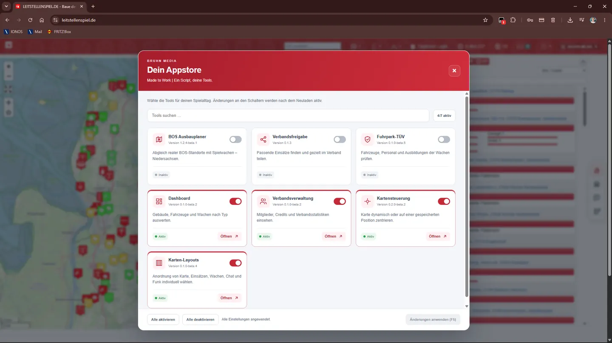
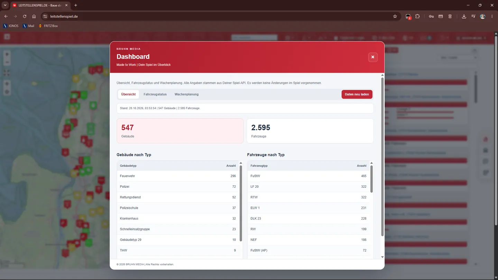
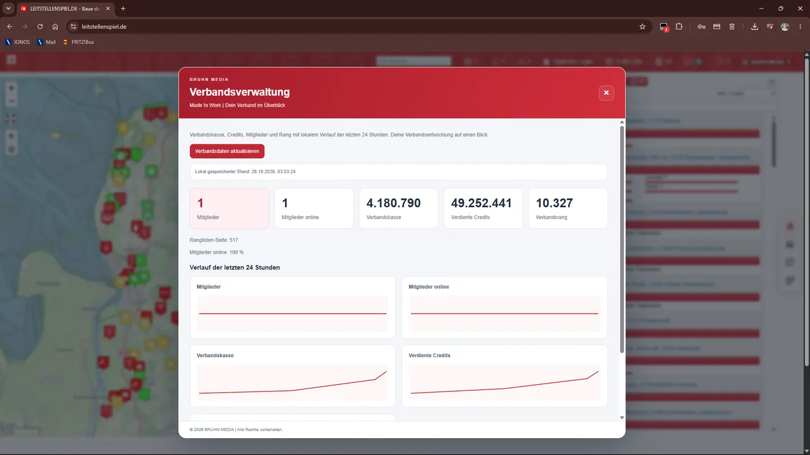
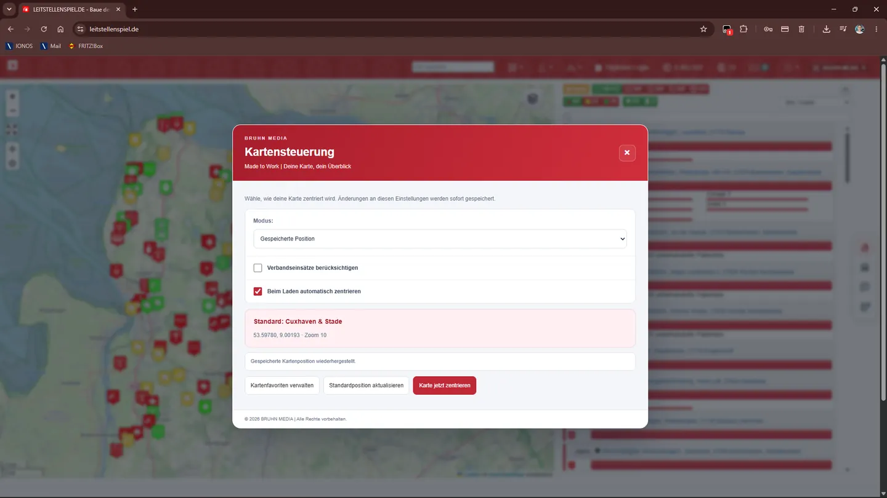
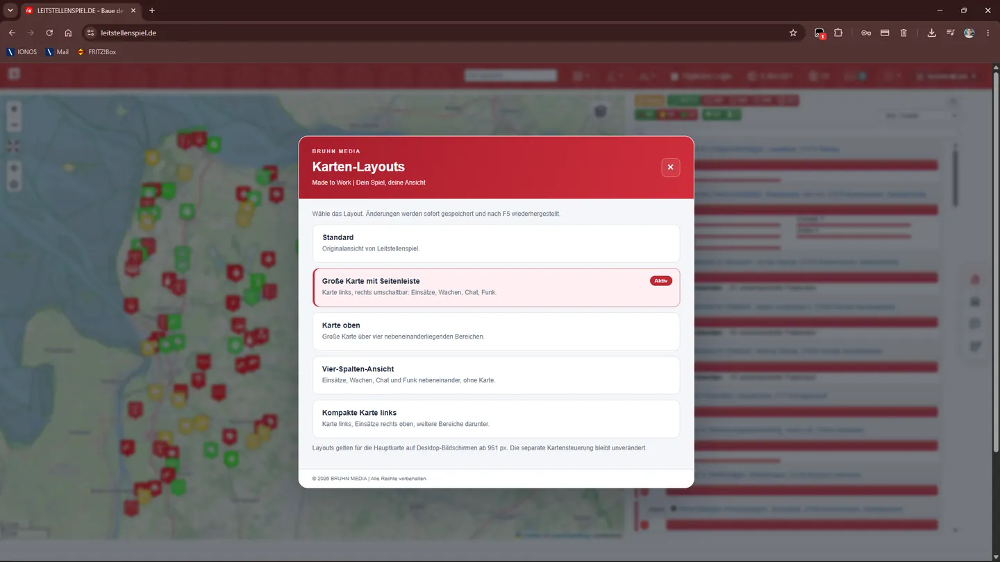
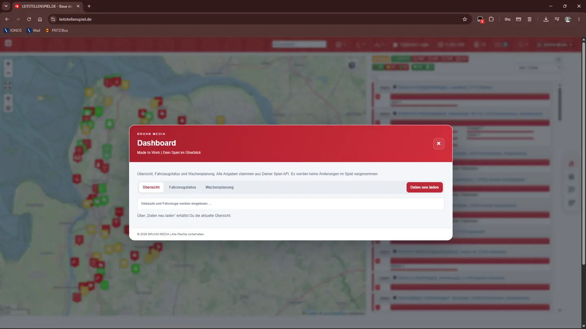

# BRUHN MEDIA | LSS Tools

**MADE TO WORK.** | Unabhängige Tools für [Leitstellenspiel.de](https://www.leitstellenspiel.de/).

## BRUHN MEDIA | Tools Manager

**Aktuelle Version: 1.3.1**

**[Tools Manager für Tampermonkey installieren](https://raw.githubusercontent.com/bruhnmedia/lss-tools-releases/main/BRUHN_MEDIA_LSS_Tools_Manager.user.js)**

## Screenshots und Einblicke

So sieht der **BRUHN MEDIA | Tools Manager** direkt im Leitstellenspiel aus. Klicke auf ein Bild, um es größer anzusehen. Die abgebildeten Werte stammen aus einer Spielumgebung.

| Appstore – Module aktivieren | Dashboard – Gebäude und Fahrzeuge |
|:---:|:---:|
|  |  |
| **Verbandsverwaltung – Statistiken und Verlauf** | **Kartensteuerung – Position und Zoom** |
|  |  |
| **Karten-Layouts – fünf Ansichten** | **Dashboard – Daten aktualisieren** |
|  |  |

Ein einziges Userscript mit eigenem **BRUHN MEDIA Appstore** und sieben unabhängig schaltbaren Modulen:

- **BOS Ausbauplaner:** Vergleicht Standorte in **Niedersachsen** mit eigenen Spielgebäuden. Zeigt zugeordnete Standorte, Prüffälle und mögliche Ausbaupotenziale. Die realen OSM-Daten sind die Vergleichsgrundlage – es gibt **keinen separaten Reale-Standorte-Tab**.
- **Verbandsfreigabe:** Unterstützt die gezielte Freigabe geeigneter Einsätze. Ein erfolgreich angeforderter Freigabe-Aufruf bleibt auch nach dem Neuladen lokal vorgemerkt; die tatsächliche Freigabe ist bei Bedarf im Einsatz zu kontrollieren.
- **Fuhrpark-TÜV:** Überblick über Fahrzeuge, Personalzuweisungen, Sonderausbildungen und den **theoretischen** Ausbildungsbedarf an Wachen. Die Angaben beweisen nicht die tatsächliche Einsatzbereitschaft.
- **Dashboard:** Auswertungen über Gebäude, Fahrzeuge und Wachen – unter anderem nach Typ, Fahrzeugstatus und Wachenplanung.
- **Verbandsverwaltung:** Einblick in Mitgliederzahlen und Verbandsstatistiken einschließlich der vom Spiel bereitgestellten Credits und Verlaufsauswertungen.
- **Kartensteuerung:** Die Karte beim Spielstart dynamisch zentrieren oder bis zu 30 benannte Favoriten mit Position und Zoom speichern. Der Stern öffnet die Favoritenverwaltung; das Zielkreuz darüber stellt den gewählten Standard wieder her. Eine bisher gespeicherte Kartenposition wird übernommen.
- **Karten-Layouts:** Fünf wählbare Desktop-Ansichten für Karte, Einsätze, Wachen, Chat und Funk: Standard, große Karte mit Seitenleiste, Karte oben, Vier-Spalten-Ansicht sowie kompakte Karte links. Die gewählte Ansicht wird gespeichert. In der Seitenleiste lassen sich Bereiche über eigenständige SVG-Icons wechseln; Listen nutzen die verfügbare Höhe und sind bei Bedarf separat scrollbar. Die Seitenleiste bleibt hinter geöffneten Einsatzfenstern.

### Installation und Bedienung

1. **Tampermonkey** installieren (falls noch nicht vorhanden).
2. [Den Tools Manager installieren](https://raw.githubusercontent.com/bruhnmedia/lss-tools-releases/main/BRUHN_MEDIA_LSS_Tools_Manager.user.js).
3. Die **alten eigenständigen BRUHN-MEDIA-Addons in Tampermonkey deaktivieren oder deinstallieren**, um doppelte Funktionen zu vermeiden.
4. Leitstellenspiel neu laden und **BRUHN MEDIA → Appstore · Tools verwalten** öffnen.
5. Gewünschte Module über die Schalter aktivieren oder deaktivieren. Änderungen gelten nach dem Neuladen. Die zusätzlichen Module Dashboard, Verbandsverwaltung, Kartensteuerung und Karten-Layouts sind bei einer Neuinstallation standardmäßig deaktiviert und können gezielt eingeschaltet werden.
6. Für **Karten-Layouts** das Modul aktivieren, neu laden und anschließend unter **BRUHN MEDIA → Karten-Layouts** eine Ansicht auswählen. Alternativ kann das aktive Modul direkt im Appstore über **Öffnen** gestartet werden. Die Layouts gelten auf der Hauptseite für Desktop-Bildschirme ab 961 px.

**Kartenfavoriten:** Kartensteuerung aktivieren, neu laden und den Stern an der Karte öffnen. „Auswählen“ stellt Position und Zoom wieder her; „Als Standard“ legt das Ziel des Zielkreuzes fest. Favoriten lassen sich umbenennen und nach Bestätigung löschen. Die Speicherung erfolgt lokal im Userscript-Speicher, ohne geräteübergreifende Synchronisierung.

**Datenabfragen:** Gleichzeitig laufende identische Abfragen werden geteilt; spätere Aktualisierungen laden frisch. Dashboard, Verbandsverwaltung und manuelle Kartenzentrierung beenden laufende Abfragen beim Schließen oder Wechseln ihrer Ansicht. Fuhrpark-Prüfungen stoppen beim Schließen; der Ausbauplaner stoppt Abrufe auch beim Minimieren und Deaktivieren. Automatische Zentrierung beim Spielstart bleibt unabhängig vom Fenster.

**Automatische Updates:** Tampermonkey nutzt die im Script hinterlegten `@updateURL`- und `@downloadURL`-Adressen. Die Datei `.meta.js` dient der Update-Prüfung und ist keine zweite Installation.

**Umstieg von Einzel-Scripts:** Die früheren Downloads wurden aus dem aktuellen Release-Repository entfernt. Ihre bisherigen Update-URLs funktionieren daher nicht mehr. Gespeicherte Einstellungen und lokale Freigabevermerke aus früheren separaten Tampermonkey-Installationen werden nicht automatisch in den Tools Manager übernommen.

## Dateien

| Datei | Funktion |
| --- | --- |
| `BRUHN_MEDIA_LSS_Tools_Manager.user.js` | Installierbarer Tools Manager |
| `BRUHN_MEDIA_LSS_Tools_Manager.meta.js` | Tampermonkey-Update-Metadaten |
| `SHA256SUMS.txt` | SHA-256-Prüfsummen der beiden Dateien |
| `LIZENZ.md` | Bedingungen für die private, nicht-kommerzielle Nutzung |

## Rechte und Datenbasis

© 2026 BRUHN MEDIA | Alle Rechte vorbehalten.

Nutzung gemäß [LIZENZ.md](LIZENZ.md).

Standortdaten © OpenStreetMap-Mitwirkende, [Open Database License 1.0](https://opendatacommons.org/licenses/odbl/1-0/). Die OSM-Daten können unvollständig oder veraltet sein.

Unabhängiges Projekt, keine offizielle Verbindung zu Leitstellenspiel.de oder den dargestellten Hilfsorganisationen.

**BRUHN MEDIA | MADE TO WORK.**
